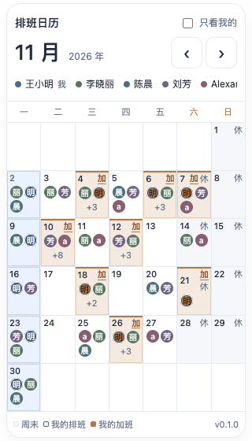
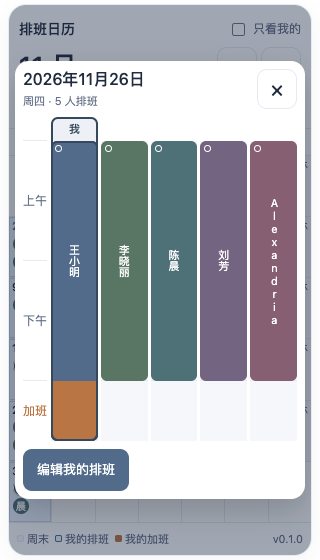

# workSchedule

面向 2–30 人团队的 H5 排班系统，支持按月查看排班，并通过日期详情查看上午、下午和加班安排。

当前版本为 **v0.1.0 方案与交互原型**。用户身份、共享数据库、管理员、操作日志、节假日同步和 Docker 部署尚未实现；原型使用模拟用户与排班数据。

## 查看方案与预览

- [完整需求与技术方案](SCHEDULING_PLAN.md)
- [独立交互预览](docs/schedule-preview.html)：克隆或下载仓库后，用现代浏览器打开此文件。
- [预览源文件](docs/schedule-preview.fragment.html)：用于继续调整界面。

预览默认展示 2026 年 11 月，可切换月份、筛选自己的排班、打开日期详情，以及选择上午、下午、加班进行模拟添加、编辑和删除。模拟编辑仅影响本机预览，不会写入共享数据库。

## 已确定的设计

- 姓名确认身份，10 种固定沉稳配色按注册顺序循环分配。
- 整月紧凑展示，末字圆形头像含 `+人数` 最多两行；本人排班高亮，本人加班显示暖色和“加”标记。
- 日期详情在当前页弹框展示，上午、下午、加班高度为 2:2:1；连续时段合并，竖排完整姓名，突出本人，多人分页。
- 成员编辑自己的排班；管理员管理全部排班和用户，按天查询操作日志。
- 节假日按年缓存，未完善数据每 72 小时重试；删除用户保留今天及历史排班，移除未来排班。

计划采用 Vue 3、TypeScript、Vant、Fastify 与 SQLite，通过 Docker 单服务部署。具体规则和开发顺序见方案文档。

## 窄屏效果

| 320px 月历 | 320px 日期详情 |
| --- | --- |
|  |  |

另有 [30 人日期的折叠展示](docs/images/schedule-home-30-320.png)。
